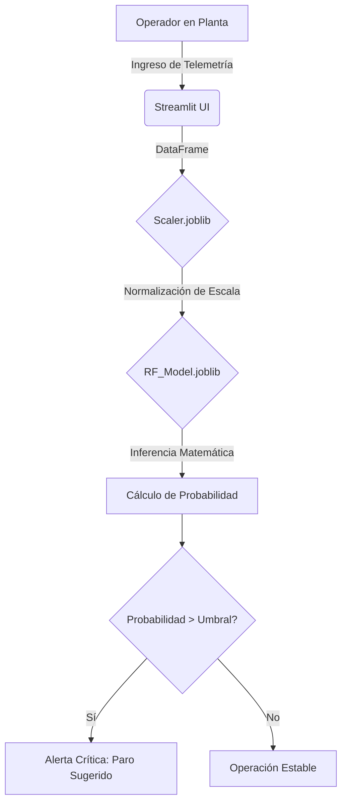

# Predictive Maintenance ML Pipeline


## 1. Descripción del Proyecto

Sistema predictivo integral (End-to-End) diseñado para anticipar fallas mecánicas críticas en maquinaria industrial CNC mediante el análisis de telemetría de sensores IIoT en tiempo real. 

El proyecto resuelve el alto costo operativo del tiempo de inactividad no planificado (Downtime) en líneas de manufactura, facilitando la transición corporativa de un modelo de mantenimiento reactivo a un esquema de mantenimiento basado en condición (CBM) y guiado por datos.

> [!IMPORTANT]
> Por políticas de control de versiones y confidencialidad, el conjunto de datos original no se encuentra alojado en este repositorio. Para replicar el entrenamiento desde el Notebook, es necesario descargar el "AI4I 2020 Predictive Maintenance Dataset" y alojarlo en el directorio `data/raw/`.

## 2. Impacto Analítico

* **Optimización de Tiempo de Actividad:** Se logró aislar y prevenir el riesgo de fallas catastróficas en fresadoras industriales, alcanzando una tasa de detección anticipada del 69% (Sensibilidad/Recall) frente a un margen de error histórico asimétrico, mediante la instanciación de un algoritmo Random Forest con ponderación de clases en Scikit-Learn.
* **Diagnóstico de Fiabilidad:** Se incrementó la asertividad operativa en planta, logrando un 70% de precisión real en las alertas de mantenimiento emitidas, aplicando técnicas de estandarización de varianza (`StandardScaler`) sobre lecturas brutas de termodinámica y torque.
* **Despliegue Operativo:** Se democratizó el acceso al motor de inferencia matemático, reduciendo el tiempo de diagnóstico manual a milisegundos, mediante el desarrollo de una interfaz web reactiva desplegada localmente con Streamlit y la serialización de artefactos con Joblib.

## 3. Stack Tecnológico

| Tecnología | Versión | Función en la Arquitectura |
| :--- | :--- | :--- |
| **Python** | 3.10+ | Lenguaje base para el desarrollo del script y la canalización de datos. |
| **Scikit-Learn** | 1.2+ | Estandarización matemática, modelado algorítmico y evaluación estadística. |
| **Pandas** | 2.0+ | Ingesta de datos multiorigen, manipulación tabular e ingeniería de características. |
| **Streamlit** | 1.20+ | Framework declarativo para la construcción y despliegue del frontend analítico. |
| **Joblib** | 1.3+ | Persistencia y serialización de modelos matemáticos hacia el disco duro. |

## 4. Estructura del Proyecto

```text
predictive-maintenance-ml-pipeline/
├── app/
│   └── app.py                  # Interfaz de usuario y motor de inferencia (Streamlit)
├── data/
│   ├── processed/              # (Ignorado en Git) Directorio para datos limpios
│   │   └── .gitkeep
│   └── raw/                    # (Ignorado en Git) Conjunto de datos originales
│       └── .gitkeep
├── models/
│   ├── rf_model.joblib         # Cerebro algorítmico exportado
│   └── scaler.joblib           # Artefacto de preprocesamiento estadístico
├── notebooks/
│   └── 01_eda_and_cleaning.ipynb # Prototipado, validación cruzada y entrenamiento
├── venv/                       # Entorno virtual aislado
├── .gitignore                  
├── requirements.txt            # Dependencias estrictas para replicabilidad
├── report.md                   # Análisis cualitativo de resultados
└── README.md                   

```

## 5. Flujo de Operación

La arquitectura del sistema abstrae la complejidad estadística detrás de un ciclo de inferencia lineal estructurado de la siguiente manera:



> [!TIP]
> **Ejecución Local:** Para arrancar la interfaz del sistema predictivo, asegúrese de tener instaladas las dependencias de `requirements.txt` en su entorno virtual y ejecute el comando `streamlit run app/app.py` desde la raíz del repositorio.

## 6. Documentación y Reportes de Negocio

El objetivo final del modelado matemático es su aplicación en la toma de decisiones operativas. Para consultar el desglose de los hallazgos técnicos, la justificación de rentabilidad frente a la matriz de confusión y el manual de acción operativo, revise la documentación gerencial anexa:

* [Reporte Ejecutivo: Implementación de Mantenimiento Predictivo en Maquinaria CNC](report.md)

---

## Autores

* **Juan Carlos López** - [JuanEnC](http://github.com/JuanEnC)
